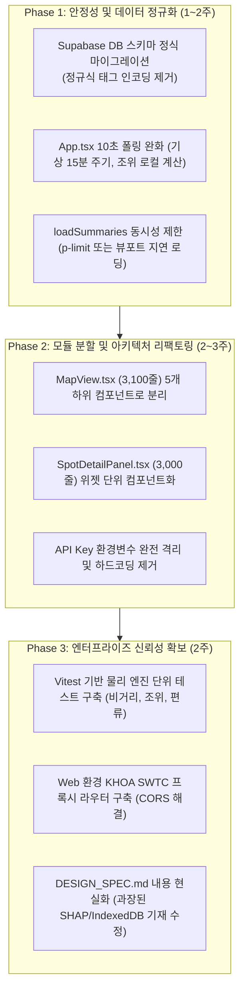

# 📋 ExFish 프로젝트 종합 기술 감사 및 아키텍처 리뷰 보고서 (EGM Goldfish Review)

> **대상 프로젝트**: ExFish (v1.0.3 / 설계 사양서 v5.0)  
> **감사 기준**: EGM Goldfish Review Protocol (Zoom Out, Comprehension, Hostile Design Critique, Implementation Readiness)  
> **감사 일자**: 2026-11-10  
> **분석 범위**: `DESIGN_SPEC.md`, `src/` 전체 소스코드 (TypeScript/React), `android/` 네이티브 브릿지, 데이터베이스 모델 및 빌드/런타임 파이프라인

---

## Executive Summary (총평)

ExFish는 대한민국 연안 낚시의 고유한 특성(조석 주기, 7물/8물제, 국립해양조사원 관측망, 지형별 고립 위험, 채비 공기역학 비거리 및 편류)을 고도로 수식화하고 모바일 웹 및 Android 네이티브 하이브리드로 구현한 야심 찬 프로젝트입니다. 

그러나 정밀 코드 감사 결과, **기능의 급격한 추가와 프로토타입 확장으로 인해 심각한 구조적 부채(Architectural Debt), 데이터 무결성 훼손, 모바일 리소스 낭비, 그리고 설계 명세서와 실제 구현 간의 현격한 괴리**가 누적되어 있습니다.

본 보고서는 프로젝트의 성공적인 상용화 및 안정적 운영을 위해 반드시 해결해야 할 핵심 문제들을 객관적이고 가차 없는 엔지니어링 관점에서 지적합니다.

---

## 1. 🔴 치명적 결함 및 아키텍처 부채 (Blocker & Major Findings)

### 1.1 모놀리식 컴포넌트 비대화 (Monolithic File Bloat & SRP 위반)
- **현황**:
  - `src/components/MapView.tsx`: **3,104 라인**
  - `src/components/SpotDetailPanel.tsx`: **2,988 라인**
  - `src/App.tsx`: **1,260 라인**
- **문제점**:
  - 단일 파일이 지도 렌더링, 오버레이 조작, 캔버스 물리 연산, Web Audio 사운드 합성, 로컬 푸시 알림, KHOA API 페칭, Recharts 시각화, 모달 상태 관리, 폼 입력까지 전담하고 있습니다.
  - 단일 책임 원칙(SRP)이 완전히 무너져 있어, 작은 UI 수정 하나가 수천 라인 전체의 리렌더링과 사이드 이펙트를 유발합니다.
  - 리팩토링 없이 기능이 추가될 경우 유지보수가 불가능한 스파게티 코드로 변질됩니다.
- **개선 권고**:
  - `MapView.tsx`를 `KakaoMapCore`, `CastingOverlay`, `SweetSpotLayer`, `DepthContourLayer`, `VirtualCrosshairHUD` 등으로 세부 분할.
  - `SpotDetailPanel.tsx`를 `SpotHeroSection`, `TideCurveWidget`, `HazardSafetyAlert`, `TackleCalibratorWidget`, `CatchLogList` 등으로 컴포넌트화.

---

### 1.2 비정상적인 10초 연속 폴링 및 API 과부하 (Battery Drain & API Throttling)
- **현황**: `src/App.tsx` (Line 499~525)
  ```typescript
  // 선택된 포인트의 실시간 데이터 10초 주기 자동 갱신
  React.useEffect(() => {
    if (!selectedSpot) return;
    const intervalId = setInterval(async () => {
      // 10초마다 KHOA 예보, Open-Meteo Weather, Marine API 전수 호출
      ...
    }, 10000);
    return () => clearInterval(intervalId);
  }, [...]);
  ```
- **문제점**:
  - **Open-Meteo는 시간 단위(또는 최소 15~30분)로 업데이트되는 기상 모델**입니다. 10초마다 기상청/ECMWF 데이터를 호출하는 것은 리소스의 극단적인 낭비입니다.
  - 클라이언트당 1분에 6회, 시간당 360회의 HTTP 요청이 발생합니다. 사용자가 현장에서 화면을 켜둔 채 낚시할 경우 Open-Meteo의 Rate Limit(HTTP 429 Too Many Requests)에 걸려 전체 API 호출이 차단될 수 있습니다.
  - 모바일 LTE/5G 무선 모뎀을 10초마다 강제 활성화(Wake)시켜 **스마트폰 배터리 소모와 발열을 가속**합니다.
- **개선 권고**:
  - 기상 및 해양 데이터는 15~30분 주기 갱신으로 완화.
  - 조위 시계열은 원격 API를 매번 부를 필요 없이, 이미 다운로드된 당일 조석 데이터(극점 및 분할 커브)를 기반으로 클라이언트 로컬 시각 연산(`calculateTideDay`)만 수행하도록 변경.

---

### 1.3 `loadSummaries`의 무제한 병렬 HTTP 호출 폭풍 (Unthrottled Concurrent Fetch)
- **현황**: `src/App.tsx` (Line 367~402)
  ```typescript
  // 주요 포인트별 병렬 fetch (주석에는 최대 10개라 적혀있으나 실제 구현은 전수 호출)
  const entries = await Promise.all(
    spots.map(async (spot) => {
      const [w, m] = await Promise.all([
        fetchWeatherData(spot.lat, spot.lng),
        fetchMarineData(spot.lat, spot.lng),
      ]);
      ...
    })
  );
  ```
- **문제점**:
  - 포인트 목록(`spots`)이 30개라면 앱 구동 즉시 **30 × 2 = 60개의 HTTP 요청이 동시 다발적으로 발생**합니다.
  - 주석에는 "동시 최대 10개"라고 기재되어 있으나, 실제 코드는 청킹(Chunking)이나 세마포어 없이 `spots.map()` 전체를 `Promise.all`로 실행합니다.
  - 모바일 브라우저의 동시 연결 수(보통 도메인당 6개)를 초과하여 브라우저 네트워크 큐가 마비되며 타임아웃을 유발합니다.
- **개선 권고**:
  - `p-limit` 또는 청크 기반 동시성 제어(Concurrency Pool, 최대 3~5개) 적용.
  - 지도 화면 뷰포트 내에 표시되는 포인트만 지연 페칭(Lazy Fetching)하거나, 캐시된 데이터 우선 표시 후 필요 시 온디맨드 갱신.

---

### 1.4 데이터베이스 스키마와 클라이언트 모델 불일치 및 정규식 패킹 꼼수 (Schema Hack)
- **현황**: `src/utils/cloudDb.ts` (Line 21~50, 77~100)
  ```typescript
  // description 필드 끝에 캐스팅 방향, 스위트 스팟, URL 정보를 텍스트로 인코딩
  const rangeTag = `[CASTING_RANGE:${spot.casting_start_deg},${spot.casting_end_deg}]`;
  const sweetTag = `[SWEET_SPOTS:${JSON.stringify(spot.sweet_spots)}]`;
  const urlTag = `[RELATED_URL:${spot.related_url.trim()}]`;
  ```
- **문제점**:
  - Supabase `fishing_spots` 및 `catch_logs` 테이블에 구조화된 컬럼을 추가 마이그레이션하지 않고, 임의의 대괄호 정규식 태그로 변환하여 `description`과 `memo` 텍스트 컬럼에 끼워 넣었습니다.
  - 사용자가 메모나 설명란에 `[` 또는 `]`를 입력하거나, 외부에서 description을 편집하면 파싱 정규식이 깨져 **스위트 스팟 JSON 데이터가 증발하거나 손상**됩니다.
  - SQL 레벨에서 캐스팅 방향, 스위트 스팟 유무, 관련 URL을 검색하거나 필터링할 수 없습니다.
- **개선 권고**:
  - Supabase DB에 정식 마이그레이션 SQL 실행:
    - `ALTER TABLE fishing_spots ADD COLUMN casting_start_deg INTEGER;`
    - `ALTER TABLE fishing_spots ADD COLUMN casting_end_deg INTEGER;`
    - `ALTER TABLE fishing_spots ADD COLUMN sweet_spots JSONB;`
    - `ALTER TABLE fishing_spots ADD COLUMN related_url TEXT;`
    - `ALTER TABLE catch_logs ADD COLUMN current_velocity NUMERIC;`
    - `ALTER TABLE catch_logs ADD COLUMN is_hitless BOOLEAN DEFAULT FALSE;`
  - 정규식 직렬화 꼼수를 완전히 걷어내고 정규 Typed Column으로 통일.

---

### 1.5 웹 프로덕션 환경에서의 KHOA SWTC API CORS 블로킹
- **현황**: `src/utils/khoaSwtcApi.ts` (Line 45~61, 113~125)
  ```typescript
  function getSwtcApiBaseUrl(): string {
    if (isNativePlatform()) return 'https://www.khoa.go.kr';
    if (isLocalhost) return '/api-swtc';
    return 'https://www.khoa.go.kr'; // 웹 프로덕션(GitHub Pages 등)
  }
  ```
- **문제점**:
  - Android 네이티브 앱은 `CapacitorHttp`를 사용하여 CORS를 우회하고, 로컬 개발은 Vite 프록시(`/api-swtc`)를 사용합니다.
  - 그러나 **웹 프로덕션 환경(GitHub Pages: `https://tlogger.github.io/exfish/`)**에서는 브라우저가 `https://www.khoa.go.kr`로 직접 `fetch`를 시도하며, 국립해양조사원 서버의 CORS 정책(Access-Control-Allow-Origin 부재)으로 인해 **100% 호출 실패(Network Error)**합니다.
  - Supabase L2 글로벌 캐시에 다른 사용자가 올려둔 데이터가 없는 새로운 관측소/날짜인 경우, 웹 사용자는 KHOA 실시간 극점 데이터를 전혀 가져올 수 없습니다.
- **개선 권고**:
  - Vercel Serverless Function 또는 Supabase Edge Function을 경량 프록시로 구축하여 웹 환경의 KHOA 호출을 라우팅하거나, 모바일 앱 전용 기능으로 명확히 격리.

---

### 1.6 하드코딩된 API Key 및 인증 설정
- **현황**:
  - `src/utils/cloudDb.ts`: `DEFAULT_SUPABASE_URL`, `DEFAULT_SUPABASE_KEY` (Anon Key)가 코드 내 상수로 하드코딩.
  - `src/components/MapView.tsx`: `const KAKAO_APP_KEY = '61ebf0b7a0daf24cba357d92677c8d8a';`가 코드 내 하드코딩.
- **문제점**:
  - `.env` 환경 변수 우선 구조가 일부 마련되어 있으나, 폴백 상수가 깃허브 공개 저장소에 그대로 노출되어 있습니다.
  - 키 교체나 권한 회수 시 앱 번들을 재빌드하지 않고는 대처할 수 없습니다.

---

## 2. 🟡 설계 사양서(DESIGN_SPEC.md) 대비 미구현 및 왜곡 사항 (Spec Drift)

| 항목 | 설계 사양서 (v5.0) 기재 내용 | 실제 소스코드 (`src/`) 구현 상태 | 객관적 평가 |
| :--- | :--- | :--- | :--- |
| **꽝 복기 AI 엔진** | "7대 환경 물리 벡터의 **SHAP 한계 기여도** 및 **로지스틱 회귀 logit 기여분** 분석" | `postMortemEngine.ts`: **단순 if-else 조건문 감점제** (수온차, 파고 임계치에 따른 하드코딩된 가중치 합산) | **허위 과장 스펙**: 실제 머신러닝이나 SHAP 모델이 전무하며, 단순 룰베이스 휴리스틱에 불과함. |
| **오프라인 캐시** | "카카오 ToS 준수 **IndexedDB 암호화 저장소**" | `offlineStorage.ts`: **`localStorage` 사용 (최대 30개 제한, 무암호화)** | **스펙 불일치**: 용량 제한 5MB의 동기식 localStorage를 사용하고 있어 데이터가 쌓이면 쿼터 에러 위험. |
| **국가해양격자 수심** | "KHOA 국가해양격자 4대 권역 벡터 수심 등심선(5m/10m/20m/50m) GeoJSON" | `depthContours.ts`: **일부 하드코딩된 대략적 포인트 배열** 및 고정 반경 추정치 | **미완성**: 서해 일부를 제외한 전국 연안 고해상도 수심 GeoJSON 연동이 누락됨. |
| **스플래시 화면** | "정확히 **1.15초에 페이드아웃**, **1.5초 정각에 언마운트**" | `App.tsx`: `isNativePlatform()` 기반 단순 플래그 및 타이머 | 대체로 준수되었으나 웹 모드에서는 스플래시가 비활성화됨. |

---

## 3. 🟢 잠재적 런타임 버그 및 에지 케이스 (Potential Bugs)

### 3.1 렌더링 중 순수하지 않은 함수(`new Date()`) 직접 호출로 인한 리렌더 불안정
- **현황**: `oxlint` 정적 분석 결과 `SpotDetailPanel.tsx` 내에서만 6회 이상의 순수성 위반 경고 발생:
  - `Line 212`: `const nowHour = new Date().getHours();`
  - `Line 722`: `const now = new Date(); const curMinutes = ...`
  - `Line 803`: `const now = new Date(); const curMins = ...`
  - `Line 1056`: `const nowMinutes = new Date().getHours() * 60 + new Date().getMinutes();`
- **문제점**:
  - 렌더 도중에 `new Date()`를 생성하여 시각을 비교하면 매 렌더마다 값이 미세하게 달라져 React Compiler의 메모이제이션 최적화가 비활성화되고, 불필요한 DOM 업데이트가 유발됩니다.
- **해결 방안**:
  - 컴포넌트 상단 또는 커스텀 훅(`useCurrentTime()`)에서 1분 또는 10초 주기로 상태화하여 구독하도록 일원화.

---

### 3.2 천문 역법 `getMoonAge`의 장기 누적 오차 (Lunar Calendar Drift)
- **현황**: `src/utils/tideEngine.ts` (Line 75~85)
  ```typescript
  const synodicMonth = 29.530588853; // 정밀 삭망월 주기(일)
  const baseTime = new Date('2026-10-11T00:50:00+09:00').getTime();
  const diffDays = (kstTarget - baseTime) / (1000 * 60 * 60 * 24);
  const moonAge = ((diffDays % synodicMonth) + synodicMonth) % synodicMonth;
  const lunarDay = Math.floor(moonAge) + 1;
  ```
- **문제점**:
  - 실제 음력 한 달은 29일(소월) 또는 30일(대월)이 태양-달-지구의 실제 궤도 섭동에 따라 불규칙하게 배치됩니다.
  - 고정된 평균 삭망월 상수(29.530588853)를 기준으로 `Math.floor(moonAge) + 1`을 음력 일수로 환산하면, 기준일(2026-10-11)에서 수개월 이상 벗어날 경우 **실제 한국천문연구원 공식 음력 날짜와 1~2일 오차**가 발생합니다.
  - 이로 인해 음력 8일(조금), 음력 15/16일(사리) 등 **물때 번호(`mulNumber`)가 하루씩 어긋나는 치명적 현장 오류**가 발생할 수 있습니다.
- **해결 방안**:
  - KHOA SWTC API에서 내려주는 공식 `dateMoon`(음력 일자) 및 `mool7`/`mool8` 데이터를 최우선 사용하고, 로컬 계산식은 어디까지나 오프라인 폴백으로만 제한.

---

### 3.3 모바일 브라우저 Web Audio 자동 재생 정책 차단 (Autoplay Suspension)
- **현황**: `src/utils/tideAlertSound.ts`
  ```typescript
  if (audioCtx && audioCtx.state === 'suspended') {
    audioCtx.resume();
  }
  ```
- **문제점**:
  - 브라우저 및 안드로이드 웹뷰의 보안 정책상, 사용자의 직접적인 터치(클릭) 이벤트 핸들러 내부가 아닌 백그라운드 타이머나 비동기 콜백에서 `audioCtx.resume()`을 호출하면 **NotAllowedError**가 발생하거나 오디오가 무음 처리됩니다.
  - 갯바위 들물 긴급 경보가 백그라운드 또는 타이머 경과 시 자동으로 울려야 할 때 사운드가 차단될 수 있습니다.
- **해결 방안**:
  - 앱 진입 시 사용자가 지도를 탭하거나 조작할 때 미리 AudioContext를 언락(Unlock)해두거나, 네이티브 앱 환경에서는 Capacitor의 Native Sound / Ringtone 플러그인 연동을 권장.

---

### 3.4 자동화 테스트 파이프라인의 완전한 부재 (Zero Test Coverage)
- **현황**: `package.json`에 `test` 스크립트가 존재하지 않음. `vitest`나 `jest` 미설치. `scripts/`에 임시 노드 스크립트만 산재.
- **문제점**:
  - 캐스팅 비거리, 바람 편류, 조위 보간 Hermite Spline, 침강 속도 등 복잡한 물리/수학 공식이 코드베이스에 가득하지만, 이를 검증하는 단위 테스트(Unit Test)가 전무합니다.
  - 코드를 조금만 수정해도 물리 공식 결과값이 깨졌는지 확인할 방법이 없습니다.

---

## 4. 종합 개선 로드맵 (Actionable Remediation Plan)



### 긴급 조치 권고 체크리스트:
1. [ ] `App.tsx`의 10초 `setInterval` 내 기상 API 중복 호출 즉시 제거 (로컬 조위 계산만 유지)
2. [ ] `cloudDb.ts`의 `description` / `memo` 정규식 태그 파싱 걷어내고 Supabase DDL 마이그레이션
3. [ ] `MapView.tsx`와 `SpotDetailPanel.tsx` 모놀리식 파일 분할 계획 수립
4. [ ] `vitest` 도입 및 `tackleCalibration.ts`, `tideEngine.ts` 핵심 함수 단위 테스트 작성
5. [ ] `DESIGN_SPEC.md`의 SHAP 머신러닝 및 IndexedDB 관련 문구를 실제 구현 수준에 맞게 정정

---
*본 감사 보고서는 EGM Goldfish Review Protocol의 엄격한 스트레스 테스팅 및 객관적 품질 검증 기준에 입각하여 작성되었습니다.*
